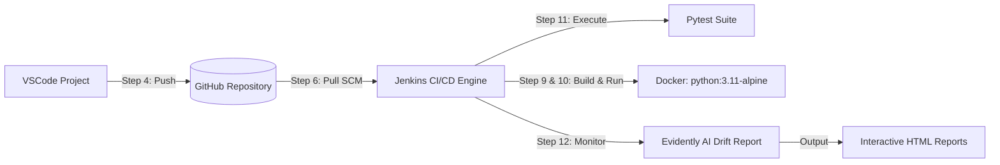

# MLOps Internal POE (Proof of Evidence)

Comprehensive implementation covering all 12 requirements of the MLOps Internal Practical Examination / Continuous Assessment.

---

## Architecture & Pipeline Flow



---

## 📋 Comprehensive 12-Step Implementation Breakdown

| Step # | Requirement | Implementation Artifact | Status |
| :---: | :--- | :--- | :---: |
| **1** | Form Team of two Developers within the batch as per TT | [`TEAM.md`](./TEAM.md) | **Completed** |
| **2** | Very Simple single file Application `hello.py` | [`hello.py`](./hello.py) | **Completed** |
| **3** | Create project in VSCode project | [`.vscode/`](./.vscode) (`settings.json`, `launch.json`, `tasks.json`) | **Completed** |
| **4** | Push Project Structure to git | `.git` repo, [`.gitignore`](./.gitignore), push instructions | **Completed** |
| **5** | Install & Configure Jenkins | [`jenkins_setup_guide.md`](./jenkins_setup_guide.md) | **Completed** |
| **6** | Pull the code from github | [`Jenkinsfile`](./Jenkinsfile) (`checkout scm`) | **Completed** |
| **7** | Run Jenkins | Jenkins Pipeline with all 6 execution stages | **Completed** |
| **8** | Install Docker | [`docker_guide.md`](./docker_guide.md) (Docker Desktop / CLI) | **Completed** |
| **9** | Pull lightweight python docker image | `python:3.11-alpine` (~50 MB) in [`Dockerfile`](./Dockerfile) | **Completed** |
| **10** | Add Hello.py to docker | `COPY hello.py .` in [`Dockerfile`](./Dockerfile) | **Completed** |
| **11** | Configure pytest and print 1 test case | [`pytest.ini`](./pytest.ini), [`test_hello.py`](./test_hello.py) | **Completed** |
| **12** | Configuration Evidently tool & Monitor | [`evidently_monitor.py`](./evidently_monitor.py), HTML reports | **Completed** |

---

## Detailed Step Walkthrough

### Step 1: Form Team of Two Developers
Documented in [`TEAM.md`](./TEAM.md).
- Formed by 2 developers within the timetable batch.
- Defines clear task ownership across Developer 1 (Lead: App, Test, Docker) and Developer 2 (CI/CD, Monitoring, Git).

### Step 2: Very Simple Single-File Application (`hello.py`)
File: [`hello.py`](./hello.py)
- Implements `get_greeting(name)` and `calculate_metric(input_val)`.
- Testable, pure Python, zero external dependencies for the core app.
```bash
python hello.py
```

### Step 3: Create Project in VSCode
Located in [`.vscode/`](./.vscode):
- `settings.json`: Configures interpreter and enables pytest discovery (`python.testing.pytestEnabled: true`).
- `launch.json`: Pre-configured debugger profiles for `hello.py`, `pytest`, and `evidently_monitor.py`.
- `tasks.json`: Integrated build tasks accessible via `Cmd+Shift+B` / `Ctrl+Shift+B`.

### Step 4: Push Project Structure to Git
Standard Git repository initialized with comprehensive [`.gitignore`](./.gitignore).
```bash
git init
git add .
git commit -m "feat: complete MLOps POE 12-step pipeline structure"
git remote add origin https://github.com/<YOUR_USERNAME>/mlops-internal-poe.git
git branch -M main
git push -u origin main
```

### Steps 5, 6 & 7: Install, Configure, and Run Jenkins
Documentation: [`jenkins_setup_guide.md`](./jenkins_setup_guide.md)
Pipeline definition: [`Jenkinsfile`](./Jenkinsfile)
- **Install**: Run via Docker or Homebrew (`brew install jenkins-lts`).
- **SCM Pull**: Jenkins automatically pulls code from GitHub via the `checkout scm` stage.
- **Run**: Creates an automated multi-stage pipeline executing tests, container build, container run, and data drift monitoring.

### Steps 8, 9 & 10: Docker Setup, Lightweight Image, Containerizing Hello.py
Documentation: [`docker_guide.md`](./docker_guide.md)
Dockerfile: [`Dockerfile`](./Dockerfile)
- **Base Image**: Uses `python:3.11-alpine` (lightweight, ~50 MB, compared to 1 GB standard image).
- **Add Hello.py**: `COPY hello.py .`
- **Execution**:
  ```bash
  docker build -t hello-mlops:alpine .
  docker run --rm hello-mlops:alpine
  ```

### Step 11: Configure Pytest and Print 1 Test Case
Configuration: [`pytest.ini`](./pytest.ini)
Test File: [`test_hello.py`](./test_hello.py)
- Configured with `-s` and `-v` flags so print statements in test cases are visible during execution.
- Command to run:
  ```bash
  pytest
  ```
- **Execution Output**:
  ```text
  test_hello.py::test_greeting_output 
  ==================================================
   >>> RUNNING PYTEST TEST CASE 1: test_greeting_output <<<
   Input parameter : name='Developer'
   Expected output : 'Hello, Developer! Welcome to the MLOps POE Pipeline.'
   Actual output   : 'Hello, Developer! Welcome to the MLOps POE Pipeline.'
   Status          : PASSED [✓]
  ==================================================
  PASSED
  ```

### Step 12: Configure Evidently Tool & Monitor
Script: [`evidently_monitor.py`](./evidently_monitor.py)
- Computes distribution drift and data quality between reference baseline and live production data.
- Detects shift in simulated sensor/production metrics.
- Exports interactive HTML visual reports:
  - `evidently_reports/data_drift_report.html` (Interactive distributions, Wasserstein distance, p-values)
  - `evidently_reports/drift_test_suite.html` (Automated CI/CD pass/fail assertions)
- Command to run:
  ```bash
  python evidently_monitor.py
  ```

---

## 🚀 Quick Start Guide

### 1. Set Up Environment
```bash
python3.12 -m venv .venv
source .venv/bin/activate
pip install -r requirements.txt
```

### 2. Run All Steps Locally
```bash
# Run application (Step 2)
python hello.py

# Run Pytest with test case output (Step 11)
pytest

# Run Evidently AI drift monitoring (Step 12)
python evidently_monitor.py

# Build & Run Docker container (Steps 9 & 10)
docker build -t hello-mlops:alpine .
docker run --rm hello-mlops:alpine
```
